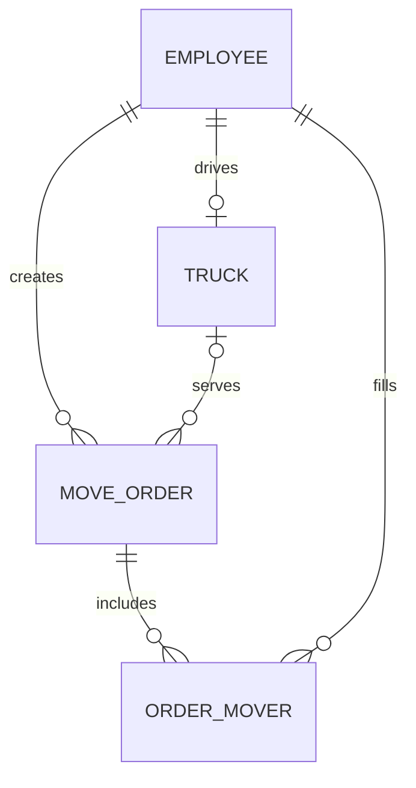

CargoFlow MVP Data Model

Entity	Fields	Purpose
Employee	Id (PK), FirstName, LastName, Role, AccountId (optional, unique when present)	Stores dispatch operators, drivers, and movers. Roles are Operator, Driver, and Mover. Operators and drivers have a sign-in account. Movers are represented as employees without accounts.
Truck	Id (PK), PlateNumber (unique), DriverId (FK to Employee.Id, required and unique)	Represents one of the eight trucks in the pilot and its designated driver.
MoveOrder	Id (PK), CustomerName, CustomerPhone, PickupAddress, DropOffAddress, ScheduledAt, Status, CreatedByOperatorId (FK to Employee.Id), TruckId (nullable FK to Truck.Id), CompletedAt (nullable)	Stores the booking, its creator, and its lifecycle. The order's driver is obtained through its truck's fixed DriverId.
OrderMover	OrderId (FK to MoveOrder.Id), MoverId (FK to Employee.Id), composite PK (OrderId, MoverId)	Connects an order to its movers. The composite key prevents a mover from appearing twice on one order.

ScheduledAt and CompletedAt store a date and time with an offset.
Business rules
- CreatedByOperatorId references an employee with role Operator, DriverId references a Driver, and MoverId references a Mover. A driver is designated to at most one truck. Truck–driver pairings stay fixed during the pilot.
- A new order has status Pending Assignment, an empty TruckId, and zero OrderMover records.
- An order with status Assigned has one truck and exactly three distinct movers. The API checks and saves the full crew and status in one transaction.
- A truck–driver pair is Busy when its truck appears on an Assigned order. A mover is Busy when an OrderMover record links them to an Assigned order. Otherwise, the resource is Available. The assignment transaction prevents the same resource from being claimed by two active orders.
- Only the assigned driver can move an order from Assigned to Completed. A completed order has CompletedAt set and retains its truck and mover references.
